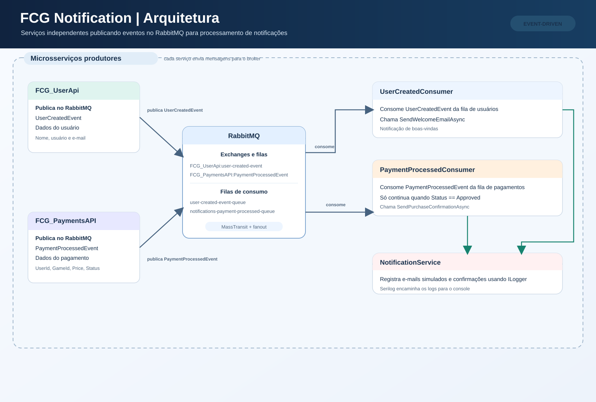
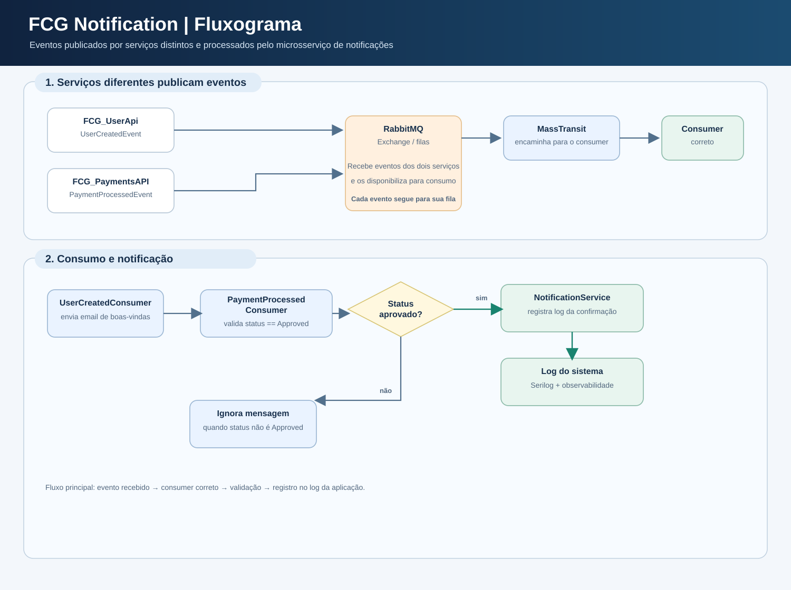

# FGC_Notification
Serviço responsável por enviar notificações aos usuários.

## Estrutura e funcionamento da API

A aplicação é um serviço .NET que processa eventos de outros serviços pelo
RabbitMQ. O MassTransit encaminha cada evento ao consumidor correspondente, e o
serviço de notificações registra a mensagem no log da aplicação, simulando o envio de email e a confirmação da compra de um jogo. Atualmente, o envio de e-mails não está integrado a um provedor externo.

```text
src/FGC_Notification/
├── Consumers/       # Consumidores dos eventos recebidos pelo RabbitMQ
├── Contracts/       # Formato dos eventos recebidos
├── Extensions/      # Registro de dependências, MassTransit e Serilog
├── Services/        # Lógica de notificação e sua interface
└── Program.cs       # Configuração e inicialização da aplicação
teste/               # Testes automatizados da aplicação
k8s/                 # Manifests Kubernetes da API e do RabbitMQ
```

Fluxos implementados:

- `UserCreatedEvent`: `UserCreatedConsumer` recebe uma notificação de boas-vindas
  com nome, usuário e e-mail.
- `PaymentProcessedEvent`: `PaymentProcessedConsumer` recebe uma confirmação
  de compra somente quando o status é `Approved`.
- `NotificationService`: registra os dados da notificação usando o `ILogger`;
  não envia e-mails de fato neste momento.

O RabbitMQ é configurado pelas opções `RabbitMq:Host`,
`RabbitMq:VirtualHost`, `RabbitMq:Username` e `RabbitMq:Password`, que podem ser
definidas por configuração ou variáveis de ambiente. A aplicação também
configura o Swagger para documentação da API.

## Arquitetura



A aplicação recebe eventos publicados por outros serviços, encaminha-os para o
RabbitMQ e os processa em consumidores específicos. O `NotificationService`
registra as notificações em log, simulando o envio de e-mail para o cliente.

## Fluxograma



O fluxo principal consiste em:

1. Publicação de um evento por outro microsserviço;
2. Entrega do evento no RabbitMQ;
3. Consumo pelo `UserCreatedConsumer` ou `PaymentProcessedConsumer`;
4. Validação do status (`Approved`) quando aplicável;
5. Registro da mensagem no log do sistema.

## Testes

Execute os testes automatizados pela solução com:

```powershell
dotnet test FGC_Notification.sln
```

Para validar a cobertura de linhas e branches:

```powershell
dotnet test FGC_Notification.sln --collect:"XPlat Code Coverage"
```

O relatório Cobertura é salvo em `teste/TestResults/`.

## Kubernetes

Os manifests em [`k8s/`](./k8s) - estão no [Repositório de Orquestração](https://github.com/pri-pereiras/FCG-Orchestration): 
